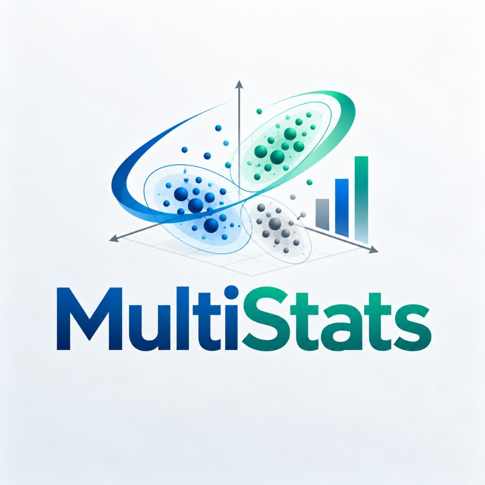

# MultiStats · Aprendizaje no supervisado

**MultiStats** es una aplicación web interactiva y modular para análisis estadístico univariado, multivariado, modelos de regresión, pruebas de inferencia y algoritmos de agrupamiento (clustering) de Machine Learning no supervisado (K-means y K-medoids).

---

## 🚀 Módulos y Arquitectura del Sistema

La aplicación está diseñada de forma modular:

1. **Gestión de Datos (`js/datos/`, `css/tabla.css`)**
   - Hoja de cálculo editable en tiempo real (estilo Excel).
   - Agregar, editar y eliminar filas y columnas.
   - Importación y exportación de archivos CSV con soporte UTF-8 (BOM).
   - Pegado directo desde hojas de cálculo externas (Ctrl+V con detección automática de encabezados).
   - Detección y validación dinámica de tipos de datos (numéricos y categóricos).

2. **Estadística Descriptiva e Inferencial (`js/estadistica/`, `css/estadistica.css`)**
   - **Análisis Univariado**: Media, mediana, moda (única, múltiple o sin moda), mínimo, máximo, rango, varianzas (muestral y poblacional), desviaciones estándar, coeficiente de variación, cuantiles (interpolación lineal tipo 7), asimetría de Fisher y curtosis ajustada.
   - **Tablas de Frecuencias**: Frecuencias absolutas, relativas, porcentuales y acumuladas para variables discretas/categóricas e intervalos continuos (regla de Sturges o número personalizado de intervalos, con medidas para datos agrupados).
   - **Análisis Multivariado y Matrices**: Covarianza muestral y poblacional, correlación de Pearson con interpretación automática, matrices completas de covarianzas y correlaciones.
   - **Regresión Lineal**: Regresión simple ($Y = b_0 + b_1 X$) y regresión múltiple ($Y = b_0 + b_1 X_1 + \dots + b_k X_k$) con resolución mediante eliminación gaussiana con pivoteo parcial, coeficientes, valores ajustados, residuos y $R^2$ / $R^2$ ajustado.
   - **Inferencia Estadística**: Intervalo de confianza de la media (t de Student), prueba t para una muestra ($H_0: \mu = \mu_0$), prueba t de Welch para dos medias independientes, IC para proporciones y prueba t para la pendiente de regresión con badges de decisión ($p$-valor vs $\alpha$).

3. **Aprendizaje No Supervisado y Resolución Paso a Paso (`js/aprendizaje/`, `css/formato_dashboard.css`)**
   - **Formato Dashboard UNA / FIEI**: Layout de 3 columnas inspirado en la Facultad de Ingeniería Estadística e Informática de la UNA Puno.
   - **Resolución Matemática Paso a Paso**: 6 tarjetas interactivas con cálculo dinámico:
     1. Media y mediana ($\bar{x} = \Sigma x_i / n$).
     2. Varianza muestral y rangos ($s^2 = \Sigma(x_i - \bar{x})^2 / (n-1)$).
     3. Desviación estándar, cuartiles y coeficiente de variación ($s = \sqrt{s^2}$, $IQR$, límites de atípicos).
     4. Covarianza muestral ($Cov = \Sigma(x_i - \bar{x})(y_i - \bar{y}) / (n-1)$).
     5. Correlación de Pearson y coeficiente de determinación ($r$, $r^2$, con interpretación cualitativa).
     6. Clúster K-Means / PAM con asignaciones, distancias a semillas, nuevos centroides y convergencia ($SCDC$).
   - **K-means**: Agrupamiento iterativo con centroides ajustables, selección dinámica de métricas de distancia (Euclidiana, Manhattan y Minkowski con parámetro $q$), opción de estandarización (media 0, desviación 1), cálculo de WCSS y visualización interactiva.
   - **K-medoids (PAM)**: Agrupamiento robusto a atípicos centrado en observaciones reales del conjunto de datos con cálculo de costo total.
   - Exportación de la resolución matemática completa a **Word (.doc)** y **PDF**.

4. **Visualización y Gráficos (`js/graficos/`, `css/graficos.css`)**
   - Gráficos nativos vectoriales SVG adaptables (viewBox) sin dependencias externas:
     - **Histogramas** por intervalos.
     - **Diagramas de Barras** para categorías.
     - **Diagrama de Caja y Bigotes (Boxplot)** con cuantiles y detección de valores atípicos.
     - **Gráficos de Dispersión** con recta de regresión estimada y ecuación ajustada.
     - **Gráficos de Clústeres** con elipses de dispersión por grupo, marcas interactivas de centroides/medoides y leyendas filtrables.
   - Exportación directa a formatos SVG y PNG (1440×840 px).
   - Navegación accesible por teclado y tooltips interactivos.

5. **Panel de Resultados y Reportes (`js/resultados/`, `css/resultados.css`)**
   - Tarjetas KPI visuales para métricas clave.
   - Tablas formateadas con alineación numérica.
   - Sistema de notificaciones flotantes (Toasts).
   - Barra de utilidades con limpieza de resultados y soporte de impresión / exportación a PDF (`@media print`).

---

## 💻 Ejecución y Uso

Simplemente abre `index.html` en cualquier navegador web moderno (Chrome, Edge, Firefox, Safari). No requiere instalación ni servidores externos: todo el cálculo y renderizado se realiza localmente en el cliente con JavaScript moderno.
